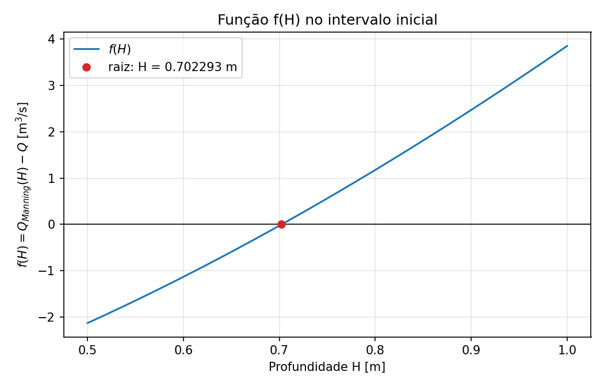
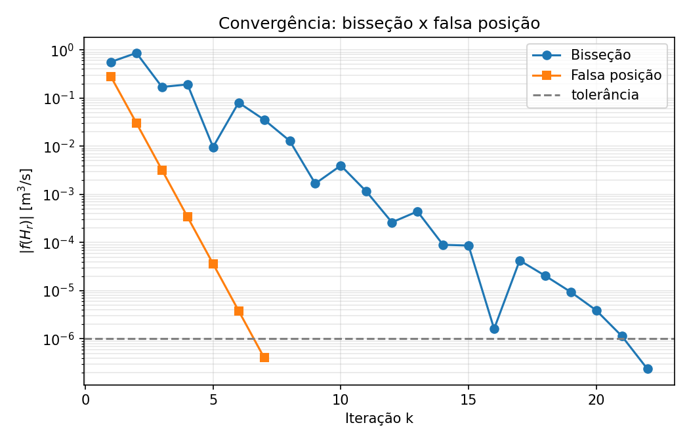

# Atividade Prática 01 - Métodos da Bisseção e da Falsa Posição

> Atividade prática proposta em aula para treinar os métodos intervalares. Não é um PPC.

## 1. Resumo operacional

Escoamento uniforme de água em um canal aberto retangular de largura $B$, inclinado em relação à horizontal. Dada a vazão volumétrica $Q$, o programa determina a **profundidade $H$ da lâmina d'água** e, a partir dela, a **velocidade média $U$** do escoamento.

A relação entre $Q$ e $H$ é não linear (equação de Manning), então $H$ não pode ser isolado algebricamente. O problema é reescrito como a busca do zero de uma função, $f(H) = 0$, e resolvido por dois métodos intervalares, a **bisseção** e a **falsa posição**, que partem do mesmo intervalo e usam o mesmo critério de parada. Em seguida os métodos são comparados.

Parâmetros do problema:

| Parâmetro | Símbolo | Valor | Unidade |
|---|---|---|---|
| Declividade do canal | $S$ | 0,0002 | m/m |
| Largura do canal | $B$ | 20 | m |
| Coeficiente de rugosidade de Manning | $n$ | 0,03 | s/m^(1/3) |
| Vazão prescrita | $Q$ | 5 | m³/s |

## 2. Fundamentação matemática

A vazão que atravessa a seção do canal é

$$Q = U A_c = U B H$$

com $A_c = BH$ a área molhada. A velocidade média é estimada pela equação de Manning:

$$U = \frac{1}{n} R^{2/3} S^{1/2}, \qquad R = \frac{A_c}{P} = \frac{BH}{B + 2H}$$

em que $R$ é o raio hidráulico e $P = B + 2H$ é o perímetro molhado. Combinando as expressões:

$$Q(H) = \frac{\sqrt{S}}{n} \, \frac{(BH)^{5/3}}{(B + 2H)^{2/3}}$$

A profundidade procurada é a raiz de

$$f(H) = Q(H) - Q = 0$$

Fisicamente, a raiz é a profundidade para a qual a vazão calculada por Manning é igual à vazão prescrita. Depois de encontrá-la, a velocidade média é $U = \dfrac{Q}{BH}$.



## 3. Algoritmos implementados

Os dois métodos partem de um intervalo $[H_l, H_u]$ em que $f$ muda de sinal, isto é, $f(H_l)\,f(H_u) < 0$. Para uma função contínua, o Teorema de Bolzano garante pelo menos uma raiz no intervalo. Aqui, $H_l = 0{,}5$ m e $H_u = 1{,}0$ m.

Em cada iteração $k$:

1. Calcula-se uma nova aproximação $H_r$ dentro do intervalo (a fórmula depende do método, veja abaixo).
2. **Critério de parada:** se $\lvert f(H_r) \rvert < 10^{-6}$, o método termina. O número de iterações é limitado a 50.
3. Atualiza-se o intervalo, mantendo sempre a mudança de sinal:
   - se $f(H_l)\,f(H_r) < 0$, então $H_u = H_r$;
   - caso contrário, $H_l = H_r$.

**Bisseção:** $H_r$ é o ponto médio do intervalo.

$$H_r = \frac{H_l + H_u}{2}$$

**Falsa posição:** $H_r$ é o ponto em que a reta que liga $(H_l, f(H_l))$ e $(H_u, f(H_u))$ cruza o eixo horizontal.

$$H_r = \frac{H_l\, f(H_u) - H_u\, f(H_l)}{f(H_u) - f(H_l)}$$

Como a **única** diferença entre os métodos é essa fórmula, o procedimento comum está escrito uma só vez em `metodo_intervalar()`, e cada método fornece apenas a sua fórmula (`ponto_bissecao` e `ponto_falsa_posicao`). Isso evita código repetido.

As tabelas mostram também o erro relativo aproximado entre iterações consecutivas, apenas como informação sobre a convergência (não é usado como critério de parada):

$$\varepsilon_a = \left| \frac{H_r^{\text{novo}} - H_r^{\text{anterior}}}{H_r^{\text{novo}}} \right| \times 100\%$$

## 4. Organização da pasta

```
01_Bissecao_Falsa_Posicao/
├── README.md                  Este arquivo
├── main.py                    Script principal: roda os dois métodos, compara e gera o relatório
├── problema_canal.py          Parâmetros e equações do problema físico (Manning); sem método numérico
├── metodos_intervalares.py    Bisseção e falsa posição (funções genéricas, servem para qualquer f(x))
├── graficos.py                Gera as figuras de outputs/ (usa matplotlib)
└── outputs/
    ├── resultados.txt                    Relatório gerado pelo main.py (tabelas, resultados e comparação)
    ├── curva_f_H.png                     Figura: f(H) e a raiz
    └── convergencia_intervalares.png     Figura: convergência dos dois métodos
```

## 5. Dicionário de variáveis

### `problema_canal.py`

| Variável no código | Significado | Unidade | Tipo |
|---|---|---|---|
| `declividade` | $S$, inclinação do canal | m/m | float |
| `largura_canal` | $B$, largura do canal | m | float |
| `rugosidade_manning` | $n$, coeficiente de rugosidade | s/m^(1/3) | float |
| `vazao_conhecida` | $Q$, vazão prescrita | m³/s | float |
| `profundidade` | $H$, profundidade da lâmina d'água | m | float |
| `area_molhada` | $A_c = BH$, área da seção ocupada pela água | m² | float |
| `perimetro_molhado` | $P = B + 2H$ | m | float |
| `coeficiente_manning` | $\sqrt{S}/n$ | m^(1/3)/s | float |

### `metodos_intervalares.py`

Os nomes são genéricos, pois as funções servem para qualquer $f(x)$: `limite_inferior` e `limite_superior` correspondem a $H_l$ e $H_u$.

| Variável no código | Significado | Unidade | Tipo |
|---|---|---|---|
| `funcao` | função $f$ cuja raiz se procura | - | função |
| `limite_inferior`, `limite_superior` | $H_l$ e $H_u$ atuais, atualizados a cada iteração | m | float |
| `tolerancia` | tolerância do critério de parada, $10^{-6}$ | m³/s | float |
| `max_iteracoes` | número máximo de iterações | - | int |
| `escolher_ponto` | fórmula que calcula $H_r$ (`ponto_bissecao` ou `ponto_falsa_posicao`) | - | função |
| `f_inferior`, `f_superior` | $f(H_l)$ e $f(H_u)$ | m³/s | float |
| `aproximacao` | $H_r$, nova aproximação da raiz | m | float |
| `f_aproximacao` | $f(H_r)$, resíduo da equação | m³/s | float |
| `aproximacao_anterior` | $H_r$ da iteração anterior | m | float ou None |
| `erro_relativo_percentual` | $\varepsilon_a$ entre iterações consecutivas | % | float ou None |
| `iteracao` | contador $k$ | - | int |
| `historico` | uma tupla por iteração: (k, $H_l$, $H_u$, $H_r$, $f(H_r)$, $\varepsilon_a$) | - | list de tuplas |
| `convergiu` | indica se o critério de parada foi atendido | - | bool |

### `main.py`

| Variável no código | Significado | Unidade | Tipo |
|---|---|---|---|
| `limite_inferior_inicial`, `limite_superior_inicial` | $H_l$ e $H_u$ iniciais | m | float |
| `tolerancia` | tolerância do critério de parada | m³/s | float |
| `max_iteracoes` | número máximo de iterações | - | int |
| `metodos` | lista de pares (nome, função do método) | - | list de tuplas |
| `profundidade` | raiz encontrada, $H$ (None se o intervalo é inválido) | m | float ou None |
| `velocidade` | $U$, velocidade média | m/s | float ou None |
| `resultados` | (nome, $H$, iterações, $U$) dos métodos que convergiram | - | list de tuplas |
| `relatorio` | linhas de texto do relatório | - | list de str |

## 6. Dependências e bibliotecas

- `main.py`, `problema_canal.py` e `metodos_intervalares.py`: apenas a biblioteca padrão do Python 3 (`math` e `os`). Nenhum pacote precisa ser instalado, e nenhuma função pronta de busca de raízes é usada.
- `graficos.py`: **matplotlib** (`pip install matplotlib`), usado somente para os gráficos.

## 7. Entradas e saídas (I/O)

**Entradas:** não há arquivos de entrada. Os parâmetros do problema ficam no início de `problema_canal.py` e a configuração dos métodos (intervalo, tolerância, máximo de iterações) fica no início de `main.py`.

**Saídas:**
- Console: para cada método, tabela com $k$, $H_l$, $H_u$, $H_r$, $f(H_r)$ e $\varepsilon_a$, seguida da profundidade encontrada, número de iterações, verificação da vazão e velocidade média; no final, a comparação dos métodos.
- `outputs/resultados.txt`: o mesmo relatório do console.
- `outputs/curva_f_H.png` e `outputs/convergencia_intervalares.png`: figuras geradas por `graficos.py`.

## 8. Procedimentos de execução

Dentro da pasta `01_Bissecao_Falsa_Posicao`:

```bash
python main.py       # resolve o problema e gera outputs/resultados.txt
python graficos.py   # gera as figuras em outputs/
```

Também funciona a partir da raiz do repositório (por exemplo, `python Atividades_Praticas/01_Bissecao_Falsa_Posicao/main.py`); as saídas são sempre salvas na pasta `outputs/` desta atividade.

## 9. Resultados

Intervalo inicial $[0{,}5;\ 1{,}0]$ m, com $f(0{,}5) = -2{,}125377$ e $f(1{,}0) = 3{,}847664$ (mudança de sinal confirmada). Relatório completo, com as tabelas de iterações, em [`outputs/resultados.txt`](outputs/resultados.txt).

| Método | Iterações | Profundidade $H$ (m) | Velocidade $U$ (m/s) |
|---|---|---|---|
| Bisseção | 22 | 0,702293 | 0,355977 |
| Falsa posição | 7 | 0,702293 | 0,355977 |



## 10. Comparação dos métodos

Respostas às questões do enunciado, com base nos resultados acima.

**a) Os dois métodos convergiram para a mesma profundidade?**
Sim. Ambos chegaram a $H = 0{,}702293$ m. A diferença entre as duas soluções é de $5{,}6 \times 10^{-8}$ m, muito menor que a precisão exibida.

**b) Qual método necessitou de menos iterações?**
A falsa posição: 7 iterações, contra 22 da bisseção, para o mesmo critério $\lvert f(H_r) \rvert < 10^{-6}$.

**c) Qual é a principal diferença entre a forma como os métodos escolhem $H_r$?**
A bisseção usa só a posição dos extremos: $H_r$ é sempre o ponto médio, e o intervalo cai pela metade a cada iteração, não importa o formato da função. A falsa posição também usa os valores de $f$ nos extremos: ela aproxima a função por uma reta entre $(H_l, f(H_l))$ e $(H_u, f(H_u))$ e toma o cruzamento dessa reta com o eixo horizontal. Quando a função é bem aproximada por uma reta no intervalo, como aqui, isso leva $H_r$ para perto da raiz muito mais rápido.

**d) Por que ambos são classificados como métodos intervalares?**
Porque trabalham com um intervalo $[H_l, H_u]$ que contém a raiz e o mantêm contendo a raiz em todas as iterações, reduzindo-o a cada passo. A raiz fica sempre "cercada", o que garante a convergência para uma função contínua.

**e) Que papel desempenha a condição $f(H_l)\,f(H_u) < 0$?**
Pelo Teorema de Bolzano, a mudança de sinal garante que existe ao menos uma raiz dentro do intervalo. A regra de atualização preserva essa mudança de sinal a cada iteração, de modo que a raiz nunca sai do intervalo. Na falsa posição ela também garante que o denominador $f(H_u) - f(H_l)$ nunca é zero.

**f) Compare a velocidade média obtida pelos dois métodos.**
Os dois métodos dão $U = 0{,}355977$ m/s (diferença de $2{,}8 \times 10^{-8}$ m/s). Como $U = Q/(BH)$ e as profundidades coincidem, as velocidades também coincidem.

**Observação sobre a falsa posição.** Na tabela, o limite superior $H_u = 1{,}0$ m não se move em nenhuma das 7 iterações: só o limite inferior avança. Por isso a largura do intervalo não vai a zero, e o critério de parada precisa ser baseado em $\lvert f(H_r) \rvert$. Esse comportamento, com um extremo "preso", é típico da falsa posição em funções com curvatura e, em outros problemas, pode fazer o método ficar mais lento que a bisseção. A bisseção, por sua vez, tem velocidade previsível: o intervalo cai pela metade a cada iteração.

## 11. Validação metodológica

**a) Resíduo da equação de Manning.** Substituindo $H = 0{,}702293$ m de volta na equação de Manning, ambos os métodos obtêm $Q(H) = 5{,}000000$ m³/s, igual à vazão prescrita. O resíduo final é $f(H_r) = 2{,}37 \times 10^{-7}$ m³/s na bisseção e $-4{,}06 \times 10^{-7}$ m³/s na falsa posição, ambos abaixo da tolerância de $10^{-6}$.

**b) Comportamento teórico da bisseção.** A largura do intervalo cai pela metade a cada iteração. Na iteração 22, a largura é $\dfrac{0{,}5}{2^{21}} \approx 2{,}4 \times 10^{-7}$ m, o que garante que o erro de $H_r$ em relação à raiz exata é menor que cerca de $1{,}2 \times 10^{-7}$ m. As colunas $H_l$ e $H_u$ da tabela da bisseção mostram esse comportamento.

**c) Comparação com solução analítica aproximada.** Para um canal muito largo ($B \gg H$), vale $P \approx B$, e a equação de Manning pode ser invertida em forma fechada:

$$H \approx \left( \frac{Q\,n}{B\sqrt{S}} \right)^{3/5} \approx 0{,}6835 \text{ m}$$

O valor numérico, 0,702293 m, é cerca de 2,7% maior. A diferença é coerente com a aproximação: ao desprezar o termo $2H$ no perímetro molhado, o raio hidráulico fica superestimado e a profundidade necessária para transportar a mesma vazão fica subestimada.

**d) Concordância entre métodos independentes.** A bisseção e a falsa posição chegam à raiz por caminhos diferentes (22 e 7 iterações) e coincidem em $5{,}6 \times 10^{-8}$ m, o que dá confiança de que as duas implementações estão corretas.

## 12. Bibliografia específica

- CHAPRA, Steven C.; CANALE, Raymond P. *Métodos numéricos para engenharia*. McGraw-Hill. (Capítulo sobre métodos intervalares: bisseção e falsa posição.)
- UNIVERSIDADE DE BRASÍLIA. Departamento de Engenharia Mecânica. *Atividade Prática de Programação: Métodos da Bisseção e da Falsa Posição*. Cálculo Numérico Aplicado (ENM0227), 2026.
