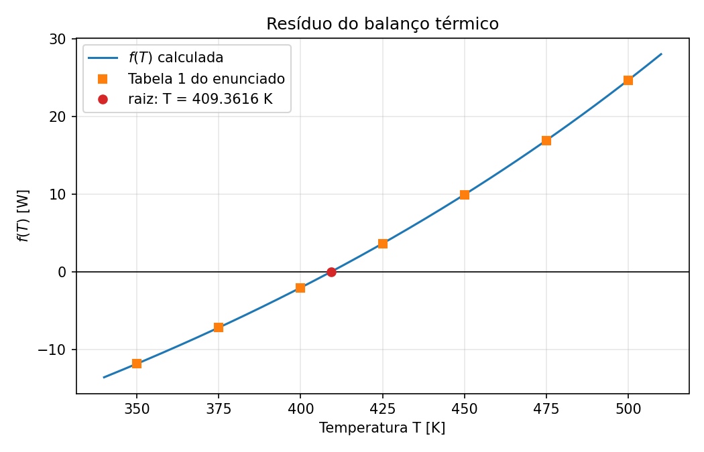
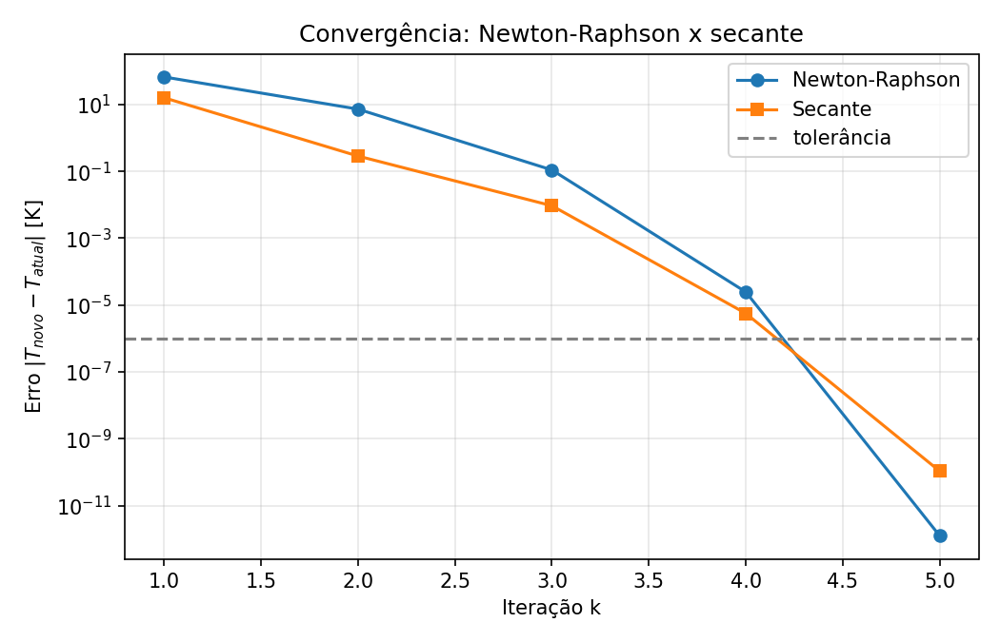

# Atividade Prática 02 - Métodos de Newton-Raphson e da Secante

> Atividade prática proposta em aula para treinar os métodos abertos. Não é um PPC.

## 1. Resumo operacional

Uma pequena superfície aquecida, de área $A$, recebe uma potência térmica constante $P$ e perde calor para o ambiente por **convecção** e por **radiação**. Em regime permanente, o programa determina a **temperatura de equilíbrio $T$** da superfície.

A equação do balanço de energia é não linear em $T$ (aparece $T^4$), então o problema é reescrito como a busca do zero de uma função, $f(T) = 0$, e resolvido por dois métodos abertos:

- **Newton-Raphson**, que usa a derivada analítica $f'(T)$;
- **Secante**, que trata $f(T)$ como uma "caixa-preta" (só recebe $T$ e devolve $f(T)$), como em uma medição experimental ou uma simulação externa, sem usar $f'(T)$.

Parâmetros do problema:

| Parâmetro | Símbolo | Valor | Unidade |
|---|---|---|---|
| Área da superfície | $A$ | 0,01 | m² |
| Coeficiente de convecção | $h$ | 10 | W/(m²K) |
| Emissividade | $\varepsilon$ | 0,8 | adimensional |
| Temperatura do ambiente | $T_\infty$ | 300 | K |
| Potência térmica fornecida | $P$ | 20 | W |
| Constante de Stefan-Boltzmann | $\sigma$ | $5{,}67 \times 10^{-8}$ | W/(m²K⁴) |

## 2. Fundamentação matemática

O balanço de energia em regime permanente iguala a potência fornecida ao calor perdido:

$$P = hA(T - T_\infty) + \varepsilon\sigma A(T^4 - T_\infty^4)$$

Reorganizando, a temperatura de equilíbrio é a raiz de

$$f(T) = hA(T - T_\infty) + \varepsilon\sigma A(T^4 - T_\infty^4) - P = 0$$

A derivada, usada apenas pelo Newton-Raphson, é

$$f'(T) = hA + 4\varepsilon\sigma A\, T^3$$

Como $f'(T) > 0$ para $T > 0$, $f$ é estritamente crescente e a raiz física é única.



## 3. Algoritmos implementados

Os dois métodos são **abertos**: não exigem um intervalo com mudança de sinal, apenas chutes iniciais. São rápidos perto da raiz, mas não têm garantia de convergência. O critério de parada é o mesmo nos dois: $\lvert T_{k+1} - T_k \rvert < 10^{-6}$ K, com no máximo 50 iterações.

**Newton-Raphson.** A próxima aproximação é onde a reta tangente à curva em $T_k$ cruza o eixo horizontal. Chute inicial: $T_0 = 350$ K.

$$T_{k+1} = T_k - \frac{f(T_k)}{f'(T_k)}$$

Se $f'(T_k) = 0$ (tangente horizontal), o método para sem convergir.

**Secante.** Substitui $f'(T_k)$ pela inclinação da reta que passa pelos dois últimos pontos:

$$f'(T_k) \approx \frac{f(T_k) - f(T_{k-1})}{T_k - T_{k-1}} \quad\Longrightarrow\quad T_{k+1} = T_k - f(T_k)\,\frac{T_k - T_{k-1}}{f(T_k) - f(T_{k-1})}$$

Chutes iniciais: $T_0 = 400$ K e $T_1 = 425$ K, em lados opostos da raiz (a Tabela 1 do enunciado mostra a mudança de sinal de $f$ entre 400 K e 425 K). A cada iteração é feita apenas **uma** nova avaliação de $f$. Se $f(T_k) = f(T_{k-1})$ (secante horizontal), o método para sem convergir.

**Leitura das tabelas.** O contador $k$ começa em 1. A coluna `T_atual` é a aproximação usada naquela iteração para calcular a próxima: na primeira linha do Newton é $T_0 = 350$ K, e na primeira linha da secante é $T_1 = 425$ K (o chute $T_0 = 400$ K aparece apenas como ponto anterior). A coluna `Erro` é $\lvert T_{novo} - T_{atual} \rvert$.

## 4. Organização da pasta

```
02_Newton_Secante/
├── README.md              Este arquivo
├── main.py                Script principal: valida f(T), roda os dois métodos, compara e gera o relatório
├── problema_termico.py    Parâmetros e equações do problema físico (balanço térmico); sem método numérico
├── metodos_abertos.py     Newton-Raphson e secante (funções genéricas, servem para qualquer f(x))
├── graficos.py            Gera as figuras de outputs/ (usa matplotlib)
└── outputs/
    ├── resultados.txt                     Relatório gerado pelo main.py
    ├── curva_f_T.png                      Figura: f(T), pontos da Tabela 1 e a raiz
    └── convergencia_newton_secante.png    Figura: convergência dos dois métodos
```

`derivada_balanco()` fica em `problema_termico.py`, mas só o Newton-Raphson a recebe. A função `secante()` nem tem parâmetro para a derivada, o que garante que a restrição do enunciado (tratar $f$ como caixa-preta) é respeitada.

## 5. Dicionário de variáveis

### `problema_termico.py`

| Variável no código | Significado | Unidade | Tipo |
|---|---|---|---|
| `area_superficie` | $A$, área da superfície | m² | float |
| `coef_convectivo` | $h$, coeficiente de convecção | W/(m²K) | float |
| `emissividade` | $\varepsilon$, emissividade | - | float |
| `temperatura_ambiente` | $T_\infty$, temperatura do ambiente | K | float |
| `potencia_termica` | $P$, potência fornecida | W | float |
| `constante_stefan_boltzmann` | $\sigma$, constante de Stefan-Boltzmann | W/(m²K⁴) | float |
| `temperatura` | $T$, temperatura da superfície (argumento das funções) | K | float |

### `metodos_abertos.py`

Os nomes são genéricos, pois as funções servem para qualquer $f(x)$: aqui `aproximacao_*` corresponde à temperatura $T$.

| Variável no código | Significado | Unidade | Tipo |
|---|---|---|---|
| `funcao` | função $f$ cuja raiz se procura | - | função |
| `derivada` | derivada analítica $f'$ (só no Newton-Raphson) | - | função |
| `chute_inicial` | $T_0$ do Newton-Raphson | K | float |
| `chute_anterior`, `chute_atual` | $T_0$ e $T_1$ da secante | K | float |
| `tolerancia` | tolerância do critério de parada, $10^{-6}$ | K | float |
| `max_iteracoes` | número máximo de iterações | - | int |
| `aproximacao_atual` | $T_k$, aproximação atual | K | float |
| `aproximacao_anterior` | $T_{k-1}$ (secante) | K | float |
| `aproximacao_nova` | $T_{k+1}$, próxima aproximação | K | float |
| `f_atual`, `f_anterior` | $f(T_k)$ e $f(T_{k-1})$ | W | float |
| `derivada_atual` | $f'(T_k)$ (Newton-Raphson) | W/K | float |
| `inclinacao_secante` | inclinação da reta secante (secante) | W/K | float |
| `erro` | $\lvert T_{k+1} - T_k \rvert$, usado no critério de parada | K | float |
| `iteracao` | contador $k$ | - | int |
| `historico` | uma tupla por iteração: (k, $T_k$, $f(T_k)$, erro) | - | list de tuplas |
| `convergiu` | indica se o critério de parada foi atendido | - | bool |

### `main.py`

| Variável no código | Significado | Unidade | Tipo |
|---|---|---|---|
| `chute_inicial_newton` | $T_0$ do Newton-Raphson | K | float |
| `chute_anterior_secante`, `chute_atual_secante` | $T_0$ e $T_1$ da secante | K | float |
| `tolerancia` | tolerância do critério de parada | K | float |
| `max_iteracoes` | número máximo de iterações | - | int |
| `temperaturas_tabela` | temperaturas da Tabela 1 do enunciado | K | list de float |
| `residuos_tabela` | valores de $f(T)$ da Tabela 1 do enunciado | W | list de float |
| `temperatura_newton`, `temperatura_secante` | temperatura de equilíbrio de cada método | K | float |
| `historico_newton`, `historico_secante` | histórico de iterações de cada método | - | list de tuplas |
| `convergiu_newton`, `convergiu_secante` | indica se cada método convergiu | - | bool |
| `relatorio` | linhas de texto do relatório | - | list de str |

## 6. Dependências e bibliotecas

- `main.py`, `problema_termico.py` e `metodos_abertos.py`: apenas a biblioteca padrão do Python 3 (`os`). Nenhum pacote precisa ser instalado, e nenhuma função pronta de busca de raízes é usada.
- `graficos.py`: **matplotlib** (`pip install matplotlib`), usado somente para os gráficos.

## 7. Entradas e saídas (I/O)

**Entradas:** não há arquivos de entrada. Os parâmetros do problema ficam no início de `problema_termico.py`; a configuração dos métodos (chutes iniciais, tolerância, máximo de iterações) e os dados da Tabela 1 do enunciado ficam no início de `main.py`.

**Saídas:**
- Console: comparação de $f(T)$ com a Tabela 1; para cada método, tabela com $k$, $T_k$, $f(T_k)$ e erro, seguida da temperatura encontrada, número de iterações, resíduo e conferência do balanço de energia; no final, a comparação dos métodos.
- `outputs/resultados.txt`: o mesmo relatório do console.
- `outputs/curva_f_T.png` e `outputs/convergencia_newton_secante.png`: figuras geradas por `graficos.py`.

## 8. Procedimentos de execução

Dentro da pasta `02_Newton_Secante`:

```bash
python main.py       # resolve o problema e gera outputs/resultados.txt
python graficos.py   # gera as figuras em outputs/
```

Também funciona a partir da raiz do repositório (por exemplo, `python Atividades_Praticas/02_Newton_Secante/main.py`); as saídas são sempre salvas na pasta `outputs/` desta atividade.

## 9. Resultados

Relatório completo, com as tabelas de iterações, em [`outputs/resultados.txt`](outputs/resultados.txt).

| Método | Chute(s) inicial(is) | Iterações | Temperatura de equilíbrio $T$ (K) |
|---|---|---|---|
| Newton-Raphson | $T_0 = 350$ K | 5 | 409,361573 |
| Secante | $T_0 = 400$ K, $T_1 = 425$ K | 5 | 409,361573 |

Na temperatura encontrada, a perda por convecção é 10,936157 W e a perda por radiação é 9,063843 W, somando exatamente a potência fornecida de 20 W.



## 10. Comparação dos métodos

Respostas às questões do enunciado, com base nos resultados acima.

**a) Os dois métodos convergiram para a mesma temperatura de equilíbrio?**
Sim. Os dois resolvem a mesma função $f(T)$, que tem uma única raiz física (pois $f$ é estritamente crescente), e ambos chegaram a $T = 409{,}361573$ K.

**b) Qual dos métodos necessitou de menos iterações?**
Nesta execução, nenhum: os dois precisaram de 5 iterações. Não é correto dizer que o Newton-Raphson foi mais rápido aqui, pois os chutes iniciais foram diferentes: o Newton partiu de 350 K, a cerca de 59 K da raiz, enquanto a secante partiu de 400 K e 425 K, bem mais perto. Na iteração 4, por exemplo, o erro da secante ($5{,}6 \times 10^{-6}$ K) já era menor que o do Newton ($2{,}5 \times 10^{-5}$ K). Em termos de custo, o Newton fez 5 avaliações de $f$ e 5 de $f'$, enquanto a secante fez 6 avaliações de $f$ e nenhuma de $f'$. Em geral, para chutes igualmente próximos, o Newton converge mais rápido por iteração (ordem 2, contra cerca de 1,62 da secante).

**c) Por que o Newton-Raphson necessita do conhecimento de $f'(T)$?**
Porque o método se baseia na reta tangente à curva no ponto atual. A derivada $f'(T_k)$ é exatamente a inclinação dessa tangente. Sem ela não é possível calcular $T_{k+1} = T_k - f(T_k)/f'(T_k)$, isto é, onde a tangente cruza o eixo horizontal.

**d) Qual é a principal vantagem da secante quando $f(T)$ vem de um experimento, de uma simulação ou de um programa externo?**
A secante só precisa dos valores de $f$: a função é tratada como uma caixa-preta. Em um experimento ou em uma simulação complexa, não existe uma expressão analítica de $f$ para derivar, então o Newton-Raphson não pode ser aplicado. A secante também faz só uma avaliação nova de $f$ por iteração, o que é importante quando cada avaliação é cara.

**e) Em que sentido a secante é uma modificação do Newton-Raphson?**
A secante é o Newton-Raphson com a derivada $f'(T_k)$ trocada por uma aproximação por diferença finita, calculada com os dois últimos pontos: $f'(T_k) \approx \dfrac{f(T_k) - f(T_{k-1})}{T_k - T_{k-1}}$. Enquanto a tangente usa um único ponto, a reta secante usa dois pontos já calculados e "imita" a inclinação da tangente quando a derivada não está disponível.

## 11. Validação metodológica

**a) Reprodução da Tabela 1 do enunciado.** A função $f(T)$ implementada reproduz os 7 valores da Tabela 1, com diferença máxima de $1{,}9 \times 10^{-7}$ W, que é apenas o arredondamento a 6 casas decimais da tabela. A comparação completa está no início de `outputs/resultados.txt` e na Figura de $f(T)$, em que os pontos da tabela caem sobre a curva calculada.

**b) Balanço de energia.** Em $T = 409{,}361573$ K, $q_{conv} + q_{rad} = 10{,}936157 + 9{,}063843 = 20{,}000000$ W, igual à potência fornecida $P$.

**c) Coerência com a mudança de sinal.** A Tabela 1 mostra $f(400) = -2{,}062$ W e $f(425) = 3{,}625$ W, então a raiz está entre 400 K e 425 K, e $409{,}36$ K está nesse intervalo. A primeira aproximação da secante, $409{,}065$ K (linha 2 da tabela), é a interpolação linear entre esses dois pontos e já está a menos de 0,3 K da raiz.

**d) Concordância entre métodos independentes.** O Newton-Raphson (que usa $f'$) e a secante (que não usa) chegam ao mesmo valor de $T$ por caminhos diferentes, o que dá confiança de que as duas implementações, e a derivada analítica, estão corretas.

## 12. Bibliografia específica

- CHAPRA, Steven C.; CANALE, Raymond P. *Métodos numéricos para engenharia*. McGraw-Hill. (Capítulo sobre métodos abertos: Newton-Raphson e secante.)
- UNIVERSIDADE DE BRASÍLIA. Departamento de Engenharia Mecânica. *Atividade Prática de Programação: Métodos de Newton-Raphson e da Secante*. Cálculo Numérico Aplicado (ENM0227), 2026.
